# poem-loop

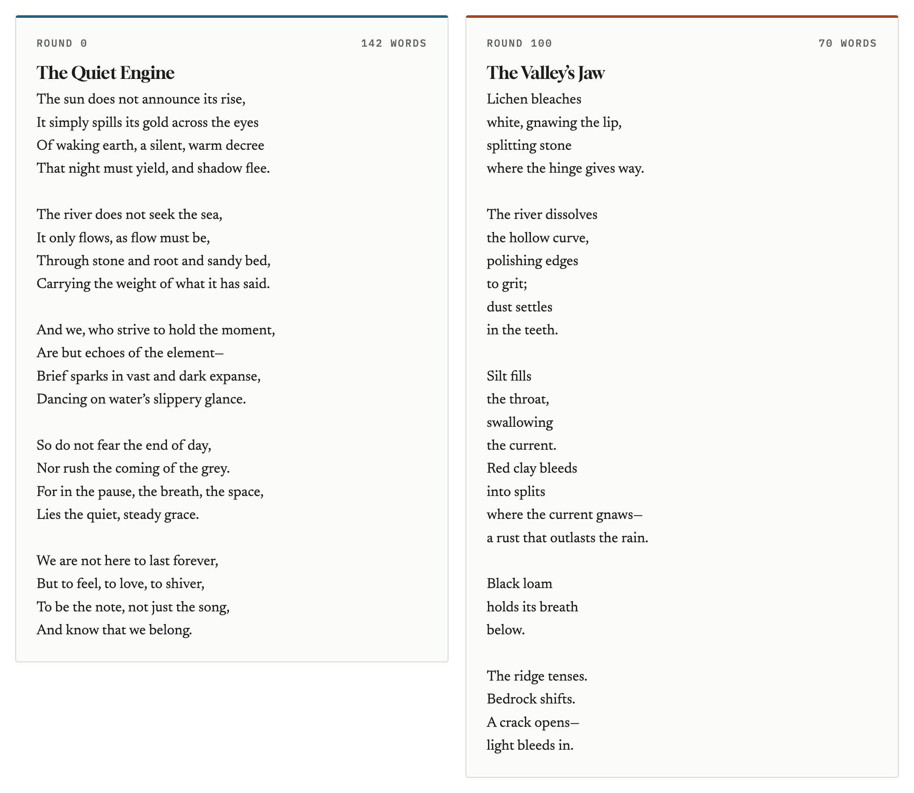

One local Qwen model writes "the perfect poem", then loops: a fresh call gives free-text feedback, a fresh
call rewrites using only that poem and that feedback. Repeat ~100 times per chain, several chains with
different seeds, then analyze whether the poem converges, cycles, or drifts, and whether separate chains end up in the same place.

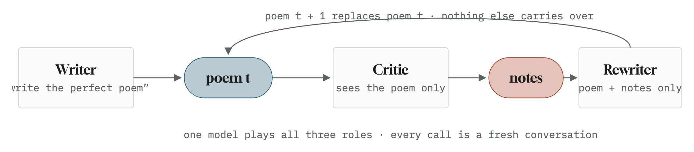

Rules this code keeps: one model plays every role, every call is stateless (one user message, no history), the judge gives free text only (no scores),
and nothing in the loop checks for convergence. The opt-in `early_stop_on_exact_repeat` is the only exception, and it is off by default.

## Findings (Qwen3.6-35B-A3B, Nov 2026)

- **It never converges.** 0/5 chains converged over 100 rounds, with no exact repeats. Consecutive poems stay ~0.90–0.93 similar, but only 12–28% of the first poem survives.

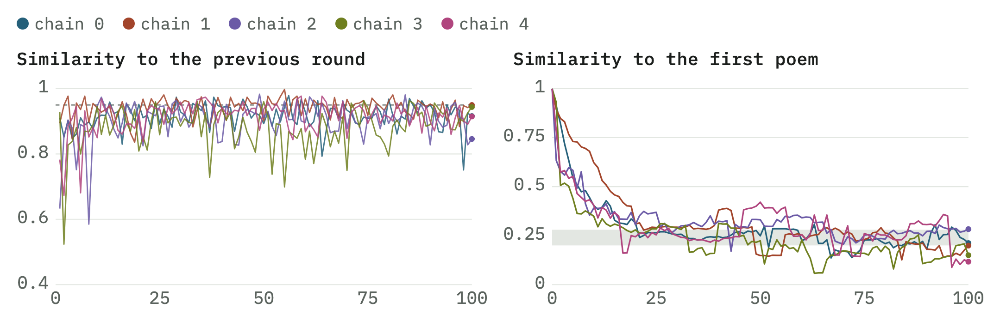

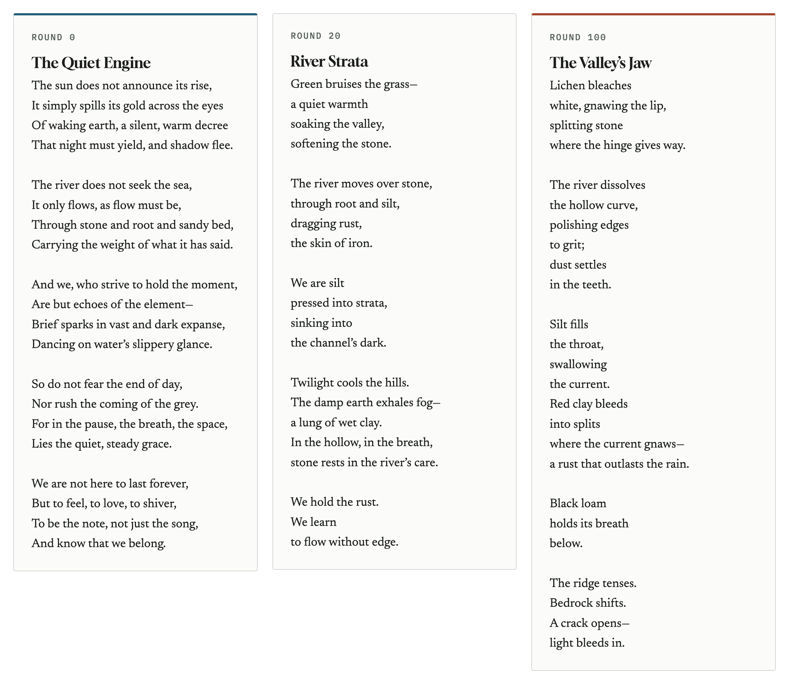

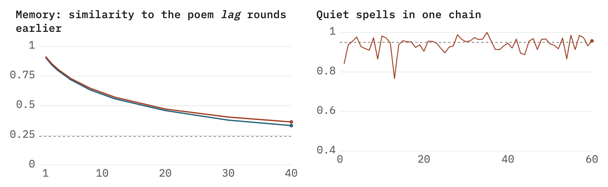

- **One attractor style.** Final poems differ in wording (cross-chain similarity 0.23) but share one dark, bodily, geological style. Rhyme falls from 29–56% to 0–11%, length roughly halves, and people disappear in 4/5 chains.

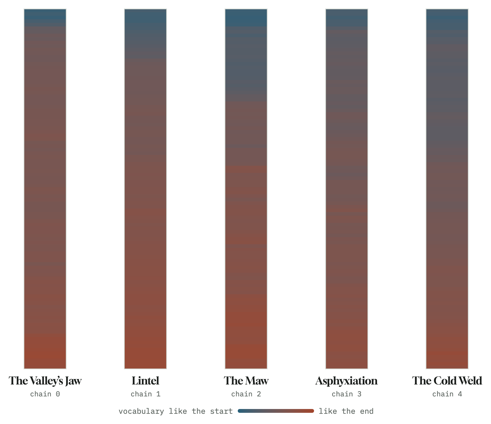

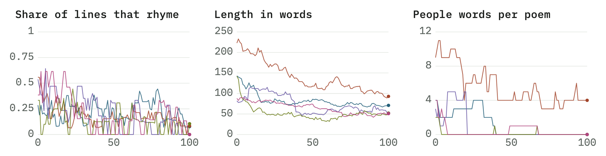

- **Temperature doesn't matter.** No phase transition from T=0 to T=1.2. Twin chains decorrelate to unrelated-poem level even at T=0, because batching float noise forks the critiques (`runs/temp_sweep`, `runs/t0_serial`).

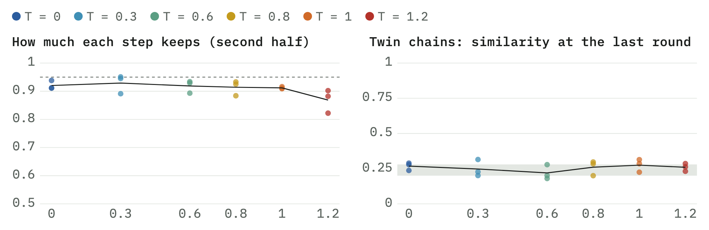

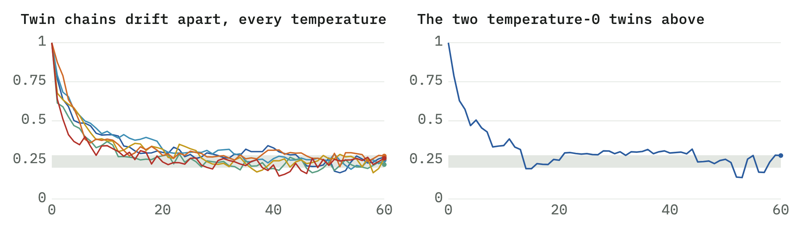

- **Every start ends up in the same basin.** Limerick, nursery rhyme, prose, random words and sonnet starts all lose rhyme and converge in style, while the subject persists as a theme (`runs/basin`).

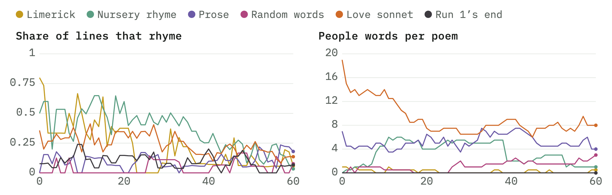

- **Climb, then plateau.** In blind pairwise judging, round 0 loses to later rounds 30/30, but single steps are a coin flip and ratings plateau at 7→8 from round 30 (`runs/eval`).

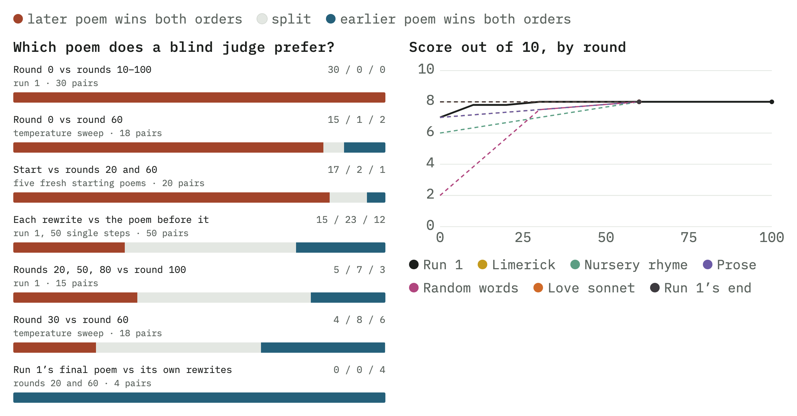

- **The critic never says it's finished.** Given an explicit FINISHED option, no chain stopped. 0/300 critiques were a bare FINISHED, and the critic signs off only after more notes (`runs/stop_critic`).
- **The critic is the engine.** Without a critic, the rewriter alone is a contracting map: fixed points or period-2 cycles and no style drift (`runs/no_critic`). A partial Qwen/Gemma role swap suggests that rhyme loss and shortening follow the critic, while diction follows the rewriter (`runs/swap`, n=3 per arm).

Write-up: `medium/post.md`.

## Install

```bash
cd ~/poem-loop
uv venv -p 3.12 .venv && uv pip install -p .venv/bin/python -r requirements.txt
# or: python3.11 -m venv .venv && .venv/bin/pip install -r requirements.txt
```

You need an OpenAI-compatible local server with a Qwen model. Set `base_url` and `model` in `config.yaml`:

| server | base_url | model example |
|---|---|---|
| llama.cpp `llama-server` (already running on this Mac) | `http://localhost:8080/v1` | `Qwen3.6-35B-A3B-UD-Q4_K_M` |
| Ollama | `http://localhost:11434/v1` | `qwen3:14b` |
| LM Studio | `http://localhost:1234/v1` | the model id LM Studio shows |

`disable_thinking: true` appends `/no_think` and sends `chat_template_kwargs.enable_thinking=false`. `<think>` blocks are stripped either way.

## Run

```bash
.venv/bin/python loop.py                              # full run from config.yaml (5 chains x 100)
.venv/bin/python loop.py --chains 1 --iterations 5    # smoke test (~2 min here)
.venv/bin/python loop.py --resume runs/<timestamp>    # continue after a crash / Ctrl-C / kill
.venv/bin/python loop.py --resume runs/<timestamp> --iterations 200   # extend a finished run
.venv/bin/python analyze.py runs/<timestamp>
```

For an overnight run, keep the Mac awake and detach the job:

```bash
caffeinate -i nohup .venv/bin/python loop.py > runs/nohup.out 2>&1 &
```

Timing on this M4 Mac with Qwen3.6-35B-A3B (Q4_K_M): about 25 s per iteration (judge ~19 s, rewrite ~6 s),
so ~42 min per 100-iteration chain and ~3.5 h for 5 chains.

Other flags: `--config`, `--prompts` (use another prompts file), `--model`, `--base-url`.
Before running, a health check confirms the server is up and the model name exists. If not, it exits with code 2 and a clear message, and no run folder is created.

## Prompts

All prompts live in `prompts.yaml` (`writer`, `judge`, `judge_knows_goal`, `rewriter`, optional `system`).
Edit them with no code changes. Each run copies the exact `config.yaml` and `prompts.yaml` it used into its folder,
and `--resume` reads those copies, so later edits don't leak into an old run.

## Output: `runs/<timestamp>/`

- `config.yaml`, `prompts.yaml`: exact copies (CLI overrides are written in)
- `chain_<n>.jsonl`: one line per iteration: `poem` *k* plus the judge's `feedback` on poem *k*
  (`feedback` is null on the last line). Fields: `chain, iteration, role, poem, poem_raw, feedback, feedback_raw,
  seed, poem_sha1, tokens_in{judge,rewrite}, tokens_out{judge,rewrite}, seconds_judge, seconds_rewrite,
  finish_reason{judge,rewrite}, seed_used, seed_sent, error, stop_reason, time`.
  `seconds_rewrite`/`tokens_*.rewrite` are for the call that *produced* this poem (the writer call for iteration 0).
- `chain_<n>.pending.json`: a freshly rewritten poem that hasn't been judged yet, so a crash between the rewrite and the judge loses nothing. It is deleted once the poem's line is written.
- `run.log`: progress, timings, errors.

Errors: if a call fails (transport errors are retried `max_retries` times), or if its output is still empty after cleaning on every retry (each retry uses a different seed),
the chain writes a line with `error` set and `stop_reason: "error"`, and the next chain starts. `--resume` removes that
error line and retries from the step that failed.

## Analysis: `runs/<timestamp>/analysis/`

`analyze.py` never calls the writer, judge, or rewriter. It writes:

- `summary.md`: for each chain, whether it converged (text similarity to the previous poem stays >= 0.95 for 10 iterations in a row) and at which iteration,
  exact cycles (repeated hash and cycle length), near-cycles (>= 0.95 similarity to a poem 2 or more steps back), drift (lines, words,
  unique/total words, rhyme share), top content words in the first 10 vs last 10 poems, and the final poem. It also has
  a chain-by-chain similarity table of the final poems (text, plus embedding cosine if available).
- `similarity.png`, `length.png`, `drift.png`
- `viewer.html`: a single self-contained page that works offline. Pick a chain and step through it with ← → (Home/End). It shows the poem, the feedback,
  a word-level diff against the previous poem, and a similarity sparkline.

Embedding metrics need `embedding_model` set (e.g. `nomic-embed-text` in Ollama, with `embedding_base_url` if it's a
different server). If it's null or fails, those metrics are skipped and everything else still runs.

## Files

`loop.py` runs the chains · `llm.py` holds `call(prompt, max_tokens, seed) -> (clean, raw, stats)`, the health check, and embeddings ·
`clean.py` strips think blocks, lead-ins, and trailing notes · `analyze.py` builds the summary, charts, and viewer.

Debug: set `POEMLOOP_DUMP_REQUESTS=/path/file.jsonl` to log every outgoing request body (this is how the
single-user-message rule was checked).
