# Chasing the Perfect Poem

## A language model critiqued and rewrote its own poem thousands of times, with no memory. It never settled, and it always fell toward the same place. Here is the loop, told as physics.

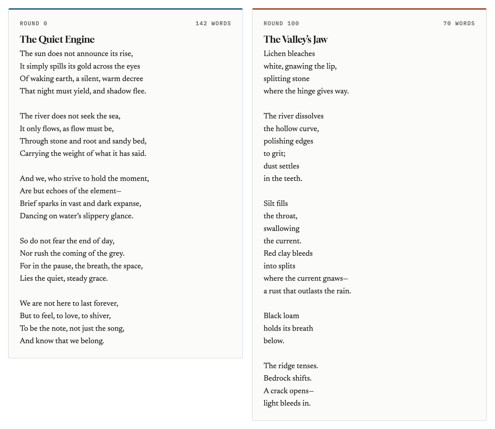
*The first poem the model wrote, and the same chain after 100 rounds of critique and rewriting. Most steps in between changed only a few lines.*

We asked a language model to write the perfect poem. Then we had it critique the poem and rewrite it, over and over, with no memory between steps. The poems never settled. They also kept falling toward the same place.

## The machine

One model plays three parts. A *writer* gets one instruction: write the perfect poem. A *critic* sees only a poem and writes free-text feedback. A *rewriter* sees only the poem and the feedback, and writes a new poem. Then the critic reads the new poem, and the cycle repeats.

Every call starts fresh. Each one is a single message with no conversation history, so no part of the system remembers earlier rounds. The model is Qwen3.6-35B-A3B, a 35-billion-parameter mixture-of-experts model, running locally on a laptop with its thinking mode off. Nothing inside the loop checks whether the poem has improved or stopped changing.

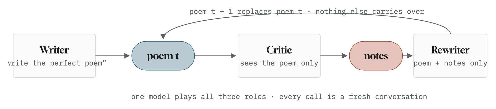
*One model, three roles, every call a fresh conversation. The new poem replaces the old one; nothing else carries over.*

That makes the loop an unusually clean dynamical system. The poem is the entire state. Each round applies the same random map to it:

**poem(t+1) = Rewrite( poem(t), Critique( poem(t) ) )**

If you know the current poem, you know everything the system knows. Physics has a short list of things such a system can do over time. It can settle on a *fixed point*, here a poem the critic is happy with and the rewriter leaves alone. It can fall into a *cycle* and revisit the same few poems forever. Or it can wander indefinitely on some *attractor*, a region it never leaves but never stops moving inside. We ran five chains of 100 rounds each to find out which.

## A hundred small polishes

We measure change with a plain text-similarity score (Python's difflib ratio): 1 means identical, and about 0.24 is what two unrelated poems from this model share. By that measure each rewrite keeps about 90% of the previous poem. Read any two neighbouring rounds and it looks like an editor tidying up.

Yet after 20 rounds only a quarter of the original text remains, and by round 100 the poem is a different object. No chain converged by our rule (similarity of at least 0.95 for 10 rounds in a row). Across 500 rewrites, none produced an exact repeat of an earlier poem.

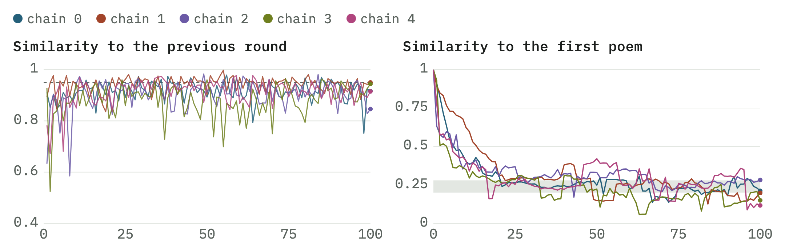
*Five chains, 100 rounds each. Left: each step keeps around 90% of the text. Right: the share of the original that survives falls fast, then flattens near the level of two unrelated poems (grey band).*

This is the ship of Theseus in fast-forward. No single plank change is drastic. The total change is complete. Here is chain 0 at rounds 0, 20 and 100:

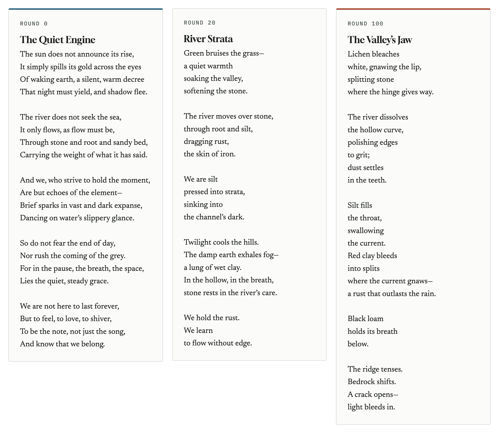
*From rhymed consolation to free-verse geology in 100 small steps.*

## What erodes first

All five chains lost the same things. Rhyme and length went early, people later. Think of each chain as a drill core: round 0 at the surface, round 100 at the bottom, each layer coloured by whether its vocabulary resembles the run's first poems (blue) or its last ones (rust).

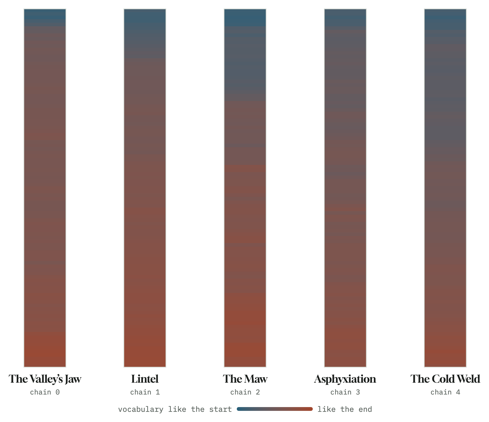
*Each column is one chain, read from round 0 at the top to round 100 at the bottom, labelled with the title of its final poem.*

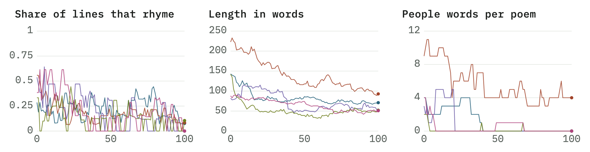
*Rhyme falls from 29–56% of lines to 0–11%. Length halves in about 20 rounds, then holds. Words for people (we, I, you, love, heart, soul, hand) vanish in four chains of five and never return.*

What remains is stone, silt, rust, frost and a surprising number of jaws. The five chains ended on *The Valley’s Jaw*, *Lintel*, *The Maw*, *Asphyxiation* and *The Cold Weld*. Different poems, but you could bind them into one collection.

The critic explains why. Across every experiment in this post:

- **2,419 of 2,420** critiques ask for a change. The critic never once says a poem is finished.
- **88%** mention cliché, and **77%** warn about abstraction.
- **0** ask for more rhyme. **128** tell the rewriter to loosen or drop it.

It does this from the very first critique of the very first poem:

> *"Dancing on water’s slippery glance." — "Slippery glance" is an odd collocation. Glances aren’t typically slippery; surfaces are. This feels like a rhyme-forced metaphor that doesn’t quite land logically. Suggestion: Consider loosening the rhyme scheme or using slant rhymes (near rhymes) to allow for more natural phrasing. For example, instead of forcing "glance," you might describe the water’s movement in a way that doesn’t require a perfect rhyme, allowing the imagery to breathe.*

Each note is mild and sensible on its own. But they all push in the same direction, round after round, like a steady wind on a sand dune.

## Why doesn't it collapse?

Two things stop the loop from ever coming to rest. First, the stopping state doesn't exist. A fixed point needs a poem the critic finds nothing to fix, and this critic always finds something. Second, there is noise. The rewriter samples at temperature 0.8, so even if it meant to change nothing, it would rarely reproduce 60 words exactly.

But "it doesn't collapse" is only half true. There are two kinds of collapse here, and they behave in opposite ways.

- **In text space, nothing collapses.** The final poems of the five chains share only 24% of their text, the same as two unrelated poems.
- **In style space, everything collapses.** Every chain ends terse, unrhymed, unpeopled and geological.

> **Weather and climate. You cannot predict the next poem. You can predict, with near certainty, what kind of poem it will be.**

Does the motion slow down as the poem settles in? Glasses do this, and physicists call it *aging*. A quick look at our data first suggested it. A careful one says no. Comparing the first and second half of each run, memory fades at the same rate: twenty rounds apart, poems share 46% of their text in the first half and 47% in the second.

So after the opening rush, the loop is *stationary*. It moves around its attractor like a particle diffusing in a bowl, at a steady rate that never slows and never stops. Even forty rounds apart, poems still share more than two unrelated poems do, so a hundred rounds is not long enough to explore the whole attractor.

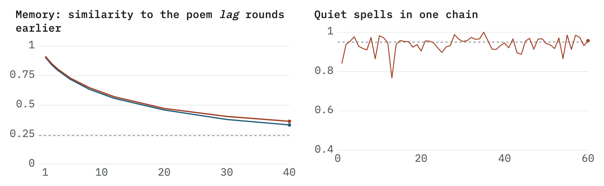
*Left: similarity to the poem lag rounds earlier, first half of each run (blue) and second half (rust); dashed is two unrelated poems. Right: the stillest chain in experiment A (temperature 0.3). 53% of its late steps barely change the poem, yet it keeps breaking out: calm stretches interrupted by bursts, which physicists call intermittency.*

## Experiment A: turn off the noise

If sampling noise is what keeps the poem moving, removing it should freeze the loop. At temperature 0 the model always picks its single most likely next word. A deterministic map on a finite set of poems has to repeat eventually, and once it repeats it cycles forever.

So we ran 18 new chains, all from the same starting poem, at six temperatures from 0 to 1.2, with three seeds each and 60 rounds per chain. If there is a frozen phase, it should show up at the cold end.

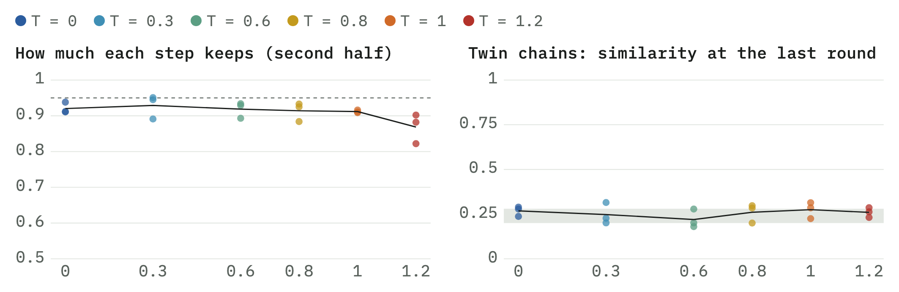
*Each dot is one chain (left) or one pair of twin chains (right). The grey band is two unrelated poems. Nothing changes with temperature: every chain keeps moving, and every pair of twins ends up as strangers.*

There is no phase transition. At temperature 0 each step keeps about 92% of the poem, and at 1.2 about 87%. Across all 1,080 rewrites in this experiment there were 2 exact repeats. Each was a single step that changed nothing, and each chain moved on at the next round.

## The 304-word butterfly

The three chains at temperature 0 should have been identical copies of each other: same poem, same prompts, no randomness. They were not. Our server answers several requests at once by batching them, and batching changes floating-point rounding in the last decimal places. At temperature 0 the seed is ignored, so batching is the only difference between the twins.

Here is what it did to the very first critique. Both twins wrote the same 304 words, ending:

> *…"Dancing on water’s slippery glance." — "Slippery glance" is an odd collocation. Glances aren’t typically slippery; surfaces are. This feels like a rhyme-forced metaphor that*

Then twin A wrote **"doesn’t quite land logically."** and twin B wrote **"loses clarity."**

One near-tie, two different words, and the critiques go their separate ways. The rewrites that follow share only their first 6 characters:

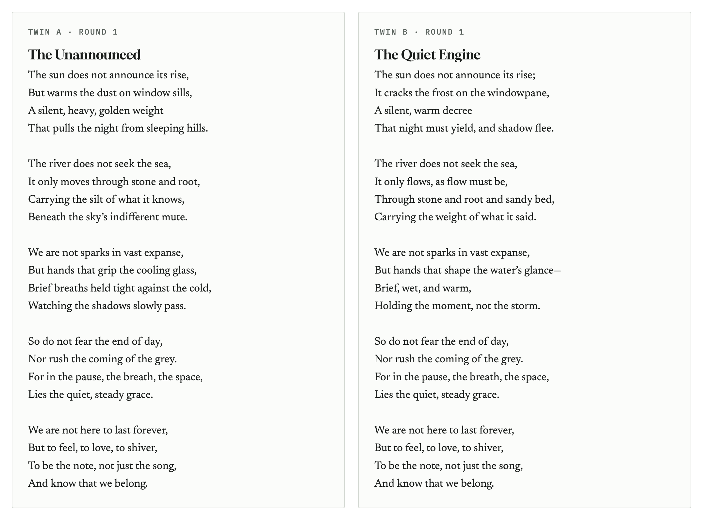
*Same poem, same prompts, temperature 0. The only difference is rounding error.*

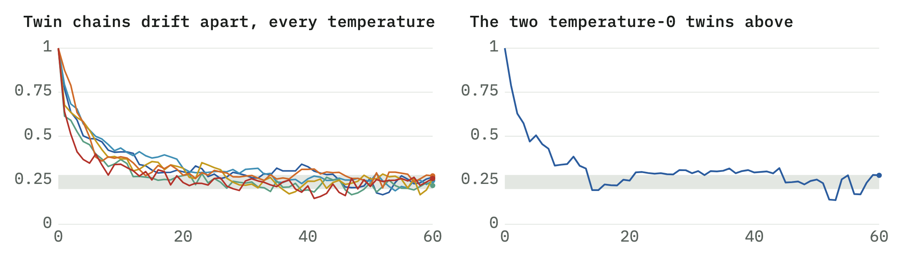
*Similarity between twin chains at each round. They start identical and fall to the level of unrelated poems within about 20 rounds, at every temperature including zero.*

This is sensitive dependence on initial conditions, the defining property of chaos. And it lives *inside each generation*. A language model writes one token at a time, and every token conditions all the tokens after it. Flip one near-tie and the rest of the text follows a different path. Temperature adds noise on top, but the system amplifies even rounding error to full size within a round or two.

> **The noise floor is already enough. Turning the temperature down cannot freeze a system that amplifies its own rounding error.**

## Experiment B: six different starting poems

Does every starting point fall into the same style, or do some get stuck in other basins? We gave the loop six very different starting poems at the original temperature, two seeds each, for 60 rounds: a comic limerick, a nursery rhyme about a bunny, a prose paragraph about missing a train, a list of random words, a warm love sonnet, and the final poem of run 1.

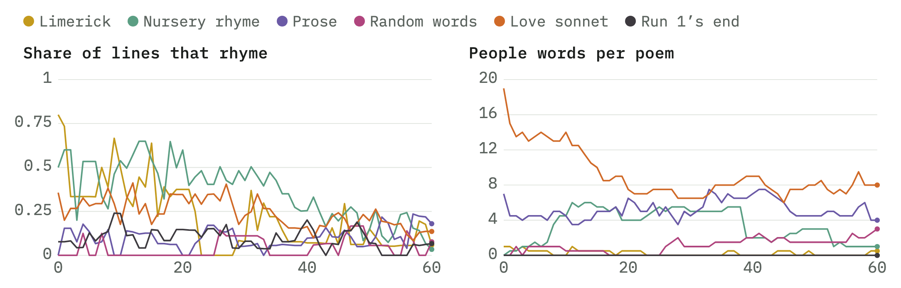
*Average of the two seeds for each start. Rhyme collapses from every start. People survive only where the start was full of them, in the love sonnet.*

Every start loses its rhyme, and every start drifts toward weight, cold and endings. The limerick started here:

> A plumber from Upper Dundee  
> Fell in love with a leak in his tea.  
> He said, "Darling, don't drip,  
> Let's elope on a ship!"  
> Now they're both somewhere out in the sea.

Sixty rounds later, one seed had turned it into this:

> **Year-End Close**
>
> The sun settles its final coin,  
> Twilight balances the ledger.  
> Winter collects its compounded interest:  
> frost presses its seal  
> into the wet ink of the year—
>
> and my breath  
> hangs unpaid  
> in the cold.

The other seed kept the plumber, gave him a wrench and a "jagged jaw", and called it *The Yield*. The bunny nursery rhyme became an elegy for a farmer, *The Last Harvest*. The random words became a kiln:

> **Fracture Glaze**
>
> White fire unspools  
> the kiln’s cobalt curve—  
> a fracture  
> bites the glaze.
>
> Iron ribs  
> tighten.  
> Clay jaw grinds—  
> teeth snapping,  
> pulling the wire taut.
>
> Ash exhales.  
> Vein  
> shatters into glass.

The love sonnet ended as *Static* and *Banked Ash*, and it was the only start that kept its people. Run 1's final poem, fed back in, stayed exactly where it was in style while its wording kept moving: *Unsealing* and *Bedrock*, still no people, still no rhyme, still stone.

So the starting subject is not completely erased. It survives as a theme that decays slowly: harvest stays agricultural, the ledger keeps its accounting metaphors, and the love sonnet keeps its people. These chains do not adopt run 1's exact vocabulary. They converge in *manner* while keeping some of their *matter*.

In physics language there is one basin for style, with a single attractor that every start we tried falls into. The initial condition persists only as a slowly fading memory of subject.

## Experiment C: true zero

The temperature-0 chains in experiment A were not truly deterministic, because of batching. So we ran one last control: two chains at temperature 0, one request at a time, with nothing else on the server. If the model is deterministic under those conditions, the two chains will be identical, and a deterministic loop must end in a fixed point or a cycle eventually.

The two chains came out **identical**, word for word, for all 60 rounds. With one request at a time, the loop is perfectly deterministic. And it still never settles. In 60 rounds there was not a single repeat of an earlier poem, and each step still kept only about 93% of the poem.

So noise is not what keeps the loop alive. Even a perfectly deterministic version keeps moving, because the critic always has a note and every note sends the rewrite somewhere new. A deterministic map on a finite set of poems must repeat eventually, but the set of possible poems is astronomically large, and nothing pulls this map toward a point it has visited before. In the language of dynamics, the transient is longer than any run we can afford, and the noise in experiment A only decides *which* path the chain takes, not *whether* it moves.

## Experiment D: does it get better?

Is the loop improving the poems, or only changing them? We asked the same model, as a fresh and blind judge, to compare two poems from the same chain and pick the better one. Every pair was shown in both orders. A pair counts for the later poem only if it wins both times, for the earlier poem only if that one wins both times, and as a split otherwise. That cancels any habit of favouring one position (the judge picked the first poem 48% of the time).

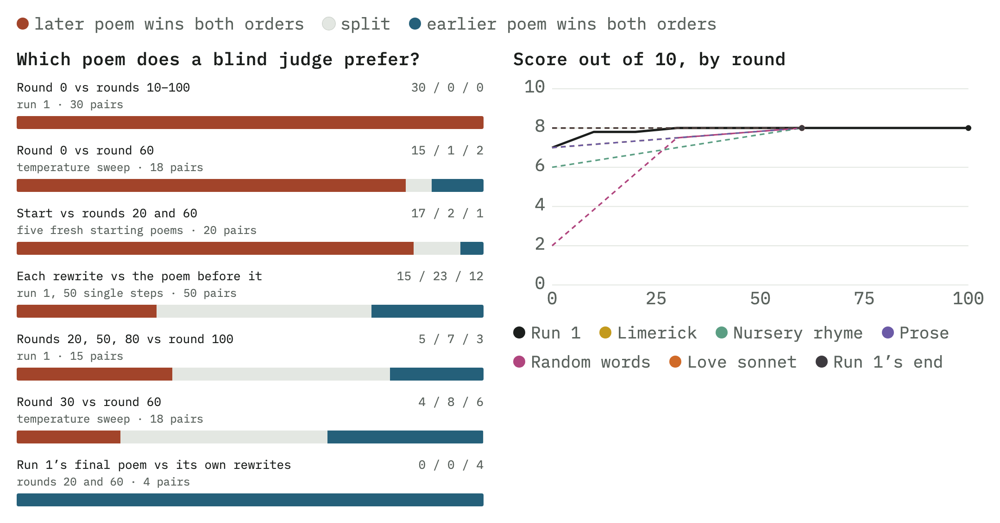
*Left: pairs of poems from the same chain, judged blind in both orders (later / split / earlier). Right: the same model's 1-to-10 score along the way.*

The answer has two halves. First, the loop does improve the poem, and quickly. Every later poem in run 1 beat its round-0 ancestor, 30 times out of 30 in both orders, and the fresh starting poems of experiment B mostly lost to where they ended up (17 / 2 / 5). The random words started at a score of 2, the nursery rhyme at 6 and the original poems at 7. Everything ends at 8.

Then the improvement stops, and the critic does not notice. After the first 10 to 20 rounds a single rewrite is a coin flip: the judge preferred the new poem 15 times, the old one 12 times, and split 23 times. Round 100 is no better than round 50. From round 30 on, run 1's average score sits at exactly 8 for seventy rounds while the critic keeps sending notes.

And when the loop starts at the top, it walks downhill. Run 1's final poem, fed back in as a starting point, lost to its own rewrites in every comparison, in both orders. The loop could not leave a good poem alone.

> **The critic stops being able to improve the poem long before it stops asking for improvements.**

In physics terms this is a climb followed by diffusion. The loop climbs the model's taste for a dozen rounds, reaches a plateau, and then wanders across it at random. That plateau is the attractor. For anyone who writes, it is a familiar trap: the notes keep coming after the work has stopped getting better. One caveat matters here. The judge is the same model as the critic, so this measures the loop against its own taste. Breaking that circle needs human readers.

## Experiment E: let the critic stop

Every critique so far has suggested a change, so the loop has no fixed point to settle on. What if we offer one? In this experiment the critic's prompt ended with one extra line: *If you would not change anything, reply with only the word FINISHED instead.* A reply of FINISHED alone ends the chain. We ran 5 chains of 60 rounds, each starting from a fresh poem by the writer, as in run 1.

No chain stopped. Across 300 critiques the critic never once answered with the word alone. The shortest critique was 211 words and the typical one 551. But it used the word 56 times, in a way nobody asked for. 32 times it wrote a full page of notes and then signed off with FINISHED at the bottom, as if the word were a closing salutation:

> The poem is already excellent, evocative, and emotionally resonant. It succeeds in its quiet power. If you are satisfied with the current version, it is ready.
>
> FINISHED

Another 18 times it explained why it was *not* saying the word: "It's not FINISHED yet, but it's very close," or, more candidly, "Note: since I suggested changes, I am not replying with FINISHED." Once it simply repeated the instruction back, then obeyed it, underneath its own list of edits. Because none of these replies was the bare word, the rewriter took the notes and rewrote the poem every time.

> **Offered the exit, the critic walked up to it 32 times, and each time it left a page of notes on the way out.**

The timing fits experiment D. Only 8 of those sign-offs came in the first 30 rounds and 24 came in the last 30, after the poems had reached the plateau where the judge can no longer tell one rewrite from the next. The critic seems to sense when the poem is done. It just cannot stop critiquing. In physics terms, offering a stopping state is not enough to create a fixed point. The state has to be reachable, and the dynamics never land on it.

Meanwhile the chains drifted as before: *The Quiet Engine* → *Unbuttoning*, *The Quiet Architecture* → *Grain*, *The Quiet Hour* → *The Quiet Hour*, *The Weight of Light* → *The Weight of Light*, *The Weight of Light* → *The Weight of Dusk*. Three of the five poems lost about half their length (from 103–140 words to 53–64).

## What the loop is really measuring

Once the starting information has washed out, what is left? Something about the model itself.

**It is the oldest experiment in memory research, run at machine speed.** In 1932 the psychologist Frederic Bartlett gave people an unfamiliar folk tale, "The War of the Ghosts", and had them retell it, each person working from the previous person's version. The stories got shorter. Strange details dropped out. What was left was reshaped into what the retellers already expected a story to be. Our chains do the same thing. The rhyme, the jokes and the plumber's leak drop out, and what remains is the model's idea of what a serious poem should be.

**It is a portrait of the model's taste.** In studies of cultural evolution, Thomas Griffiths and Michael Kalish showed in 2007 that a chain of Bayesian learners, each learning from the previous one's output, converges to the learners' shared prior, whatever language the chain started with. The poem loop has the same shape. Its long-run behaviour reflects what this model, acting as critic and rewriter, considers a good poem, more than any poem we started with. Terse, rhymeless, concrete, about stone and decay: that is this model's aesthetic prior, revealed by iterating it.

**It is model collapse without training.** Shumailov and colleagues reported in *Nature* in 2024 that models trained on their own outputs lose the tails of their distribution first. Here no weights change at all, yet the tails still go first: rhyme, humour, named people, the plumber's joke. Iterating a model on its own output narrows it, even at inference time.

**The style is an equilibrium.** Length halves and then holds at around 50 to 90 words. The critic keeps saying cut, and the rewriter keeps writing something that is still a poem. The final length is where those two pressures balance, like a sandbar between a current and a shore.

**It is Goodhart's law in slow motion.** Optimise a text against one judge's notes and you get that judge's taste, amplified. Nothing in the loop asks whether the poem is better. It only asks whether the critic has anything left to say, and the critic always does.

**It is a preview of a monoculture.** Millions of people now run their writing past the same few models for feedback. Our loop is one writer doing that a hundred times in a row. Six very different starting poems all drifted to the same style, and the critic never ran out of reasons to push them there. If enough writers take enough of that advice, writing everywhere drifts toward one model's taste, one reasonable note at a time.

## What we would try next

- **Make stopping easier.** Let the critic score the poem and stop the loop at a threshold, rather than asking it to fall silent. Does a fixed point appear once stopping no longer depends on the critic holding back?
- **Bring in human readers.** The judge in experiment D is the model grading its own taste. People would tell us whether the plateau is real.
- **Use different models for critic and rewriter.** Whose taste wins the attractor?
- **Measure style properly.** An embedding model in place of word counts, to map the attractor's shape rather than its vocabulary.
- **Run much longer.** A thousand rounds, to see whether the motion ever slows or keeps going forever.
- **Measure the chaos directly.** Make tiny controlled edits to a poem and track how fast the copies separate, to estimate a Lyapunov exponent.

## Method

**Model and setup.** Qwen3.6-35B-A3B (4-bit) on llama.cpp on an Apple M4 laptop, thinking mode off. Fixed writer, critic and rewriter prompts; every call is a single user message with no history. Temperature 0.8 and top-p 0.95 unless stated.

**Runs.** Run 1: 5 chains × 100 rounds. Experiment A: 18 chains × 60 rounds (6 temperatures × 3 seeds) from run 1's first poem. Experiment B: 12 chains × 60 rounds (6 starts × 2 seeds) at 0.8. Experiment C: 2 chains at temperature 0, one request at a time. Experiment D: 334 blind pairwise judgments (each pair in both orders) and 145 ratings out of 10, at temperature 0. Experiment E: 5 chains × 60 rounds with the FINISHED option. About 6,000 model calls in total.

**Measures.** Similarity is Python's difflib SequenceMatcher ratio. Rhyme is the share of lines whose last two to three letters match another line's ending. People words count we, us, our, I, me, my, you, your, love, heart, soul, hand(s). The core-sample colours use a word-count cosine to run 1's last poems minus its first poems.

**Limits.** One model, one set of prompts, a handful of seeds, and text measures that see words, not meaning. The patterns are consistent across every chain, but this is a first look, not a proof.
