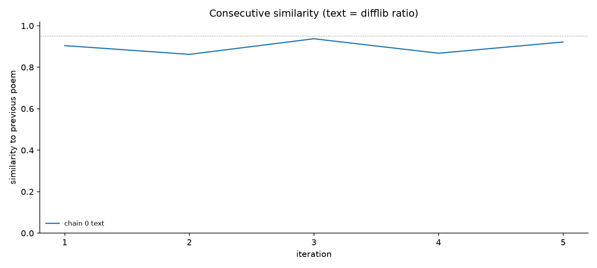
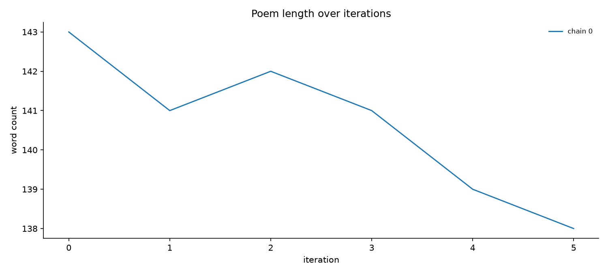
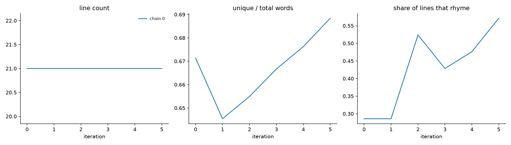

# Poem loop analysis: `2026-11-07_194602`

Model `Qwen3.6-35B-A3B-UD-Q4_K_M` · 1 chains · temperature 0.8 · judge_knows_goal=False

Embeddings: skipped (embedding_model not set)

Converged = first iteration where text similarity to the previous poem stays >= 0.95 for 10 iterations in a row.







## Overview

| chain | poems | converged | exact repeats | near-cycles (>=0.95, 2+ back) | mean text sim (last 10) | errors |
|---|---|---|---|---|---|---|
| 0 | 6 | did not converge | none | none | 0.899 | 0 |

## Do chains end up in the same place?

Text similarity (difflib) between the **last** poem of each chain:

| | c0 |
|---|---|
| c0 | 1.00 |

## Chain 0

- **Did not converge.**
- No exact repeats.
- No near-cycles.
- Drift, first -> last: lines 21 -> 21, words 143 -> 138, unique/total 0.67 -> 0.69, rhyme share 0.29 -> 0.57
- Top content words, first 10 poems: silent, day, water, quiet, gray, cold, sun, night, river, stone
- Top content words, last 10 poems: silent, day, water, quiet, gray, cold, sun, night, river, stone

**Final poem (iteration 5):**

```
**The Silent Current**

The sun steals light without a sound,
It bleaches out the fading ground,
A silent tide that pulls the day
To wash the night’s cold gray away.

The river seeks no grand design,
It only falls, and so it shines,
Through jagged stone and tangled root,
Carrying what it cannot choose.

We are the foam that breaks and dies,
Brief bubbles in the water’s guise,
Reflected in its passing glance,
Before they vanish, once and hence.

So do not fear the end of day,
Nor rush the coming of the gray.
For in the pause, the breath, the space,
Lies quiet, steady, deep grace.

We are not here to last forever,
But to feel the cold, to love, to shiver,
To be the note within the song,
Then dissolve into the deep unknown.
```
