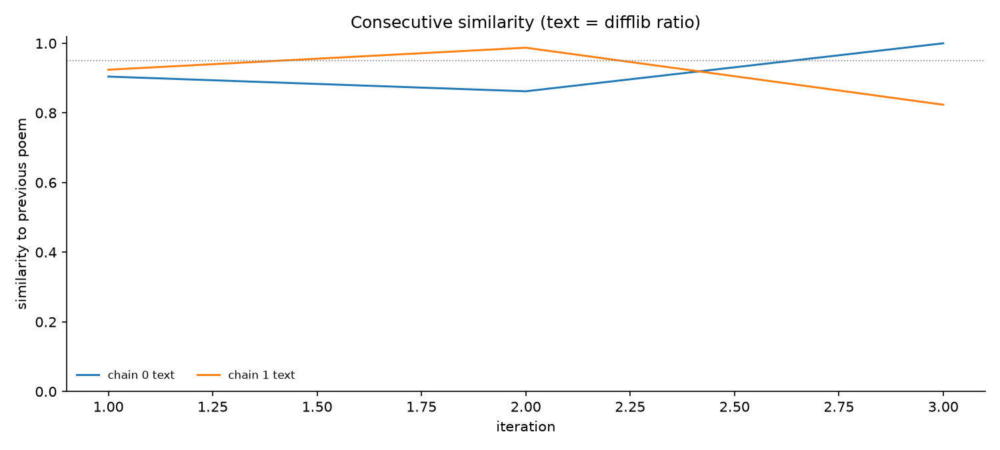
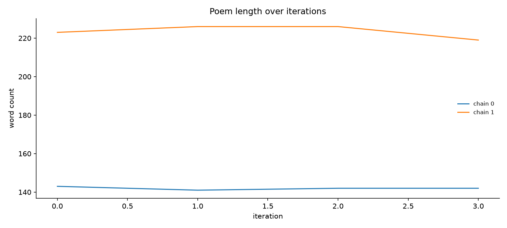
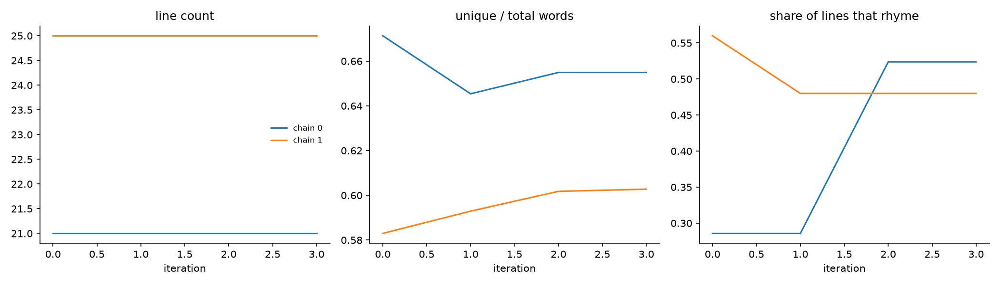

# Poem loop analysis: `2026-11-07_194914`

Model `Qwen3.6-35B-A3B-UD-Q4_K_M` · 2 chains · temperature 0.8 · judge_knows_goal=False

Embeddings: skipped (embedding_model not set)

Converged = first iteration where text similarity to the previous poem stays >= 0.95 for 10 iterations in a row.







## Overview

| chain | poems | converged | exact repeats | near-cycles (>=0.95, 2+ back) | mean text sim (last 10) | errors |
|---|---|---|---|---|---|---|
| 0 | 4 | did not converge | 1 (first at 3, cycle 1) | none | 0.922 | 0 |
| 1 | 4 | did not converge | none | none | 0.912 | 0 |

## Do chains end up in the same place?

Text similarity (difflib) between the **last** poem of each chain:

| | c0 | c1 |
|---|---|---|
| c0 | 1.00 | 0.27 |
| c1 | 0.27 | 1.00 |

Mean off-diagonal text similarity: **0.274**

## Chain 0

- **Did not converge.**
- Exact repeats: 1; first: poem 3 == poem 2 (cycle length 1). Lags seen: [1]
- No near-cycles.
- Drift, first -> last: lines 21 -> 21, words 143 -> 142, unique/total 0.67 -> 0.65, rhyme share 0.29 -> 0.52
- Top content words, first 10 poems: water, quiet, silent, day, flow, sun, announce, rise, waking, night
- Top content words, last 10 poems: water, quiet, silent, day, flow, sun, announce, rise, waking, night

**Final poem (iteration 3):**

```
**The Silent Current**

The sun does not announce its rise,
It spills across the waking skies,
A silent tide that pulls the day
To wash the night’s cold gray away.

The river seeks no grand design,
It only falls, and so it shines,
Through stone and root and silted bed,
Carrying the weight of what it led.

And we, who strive to hold the now,
Are bound by water’s ebb and flow,
Brief sparks in vast and dark expanse,
Reflected in a water’s glance.

So do not fear the end of day,
Nor rush the coming of the grey.
For in the pause, the breath, the space,
Lies the quiet, steady grace.

We are not here to last forever,
But to feel, to love, to shiver,
To be the note, not just the song,
And know that we belong.
```

## Chain 1

- **Did not converge.**
- No exact repeats.
- No near-cycles.
- Drift, first -> last: lines 25 -> 25, words 223 -> 219, unique/total 0.58 -> 0.60, rhyme share 0.56 -> 0.48
- Top content words, first 10 poems: quiet, world, gold, silence, dark, architecture, sun, shout, simply, arrives
- Top content words, last 10 poems: quiet, world, gold, silence, dark, architecture, sun, shout, simply, arrives

**Final poem (iteration 3):**

```
**The Quiet Architecture**

The sun does not shout; it simply arrives,
Laying a warm hand on the waking stone,
A slow, white truth that the darkness survives,
Bending the frost’s rigid will to its own.
It waits until the granite forgets the cold,
And the river, unbound by the edge of the gate,
Turns stories to silence, and secrets to gold,
Until the dark and the light are at weight.

We are brief as the heat in the lung of the air,
A spark in the dark, then the ash, then the dust,
But we stitch up the tear in the fabric of care
With hands that remember how trust must
Be held in the silence, not shouted in pride,
Like the root that holds fast in the cracking soil,
The echo that lingers, the open eye
Watching the peace that settles, the lost, by the oil.

Let the world spin on its axis of fire,
Let stars burn out and the galaxies fade,
We are here, just here, in the deep and the higher,
In the mess and the magic that love has made.
Not in the grandeur, the monument, or the name,
But in the quiet space between heartbeats two,
Where nothing remains but the gentle flame,
And the world, for a moment, is perfectly true.
```
