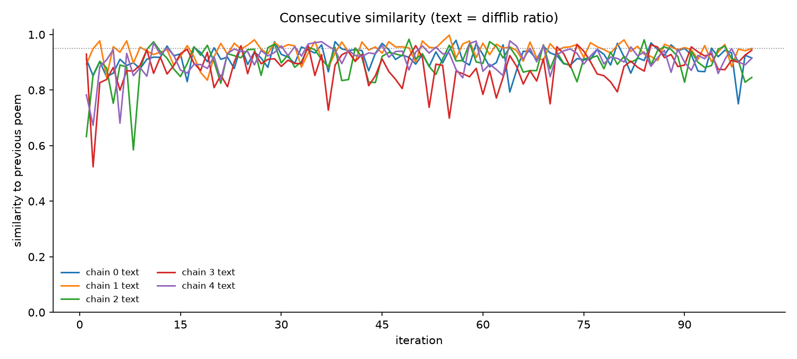
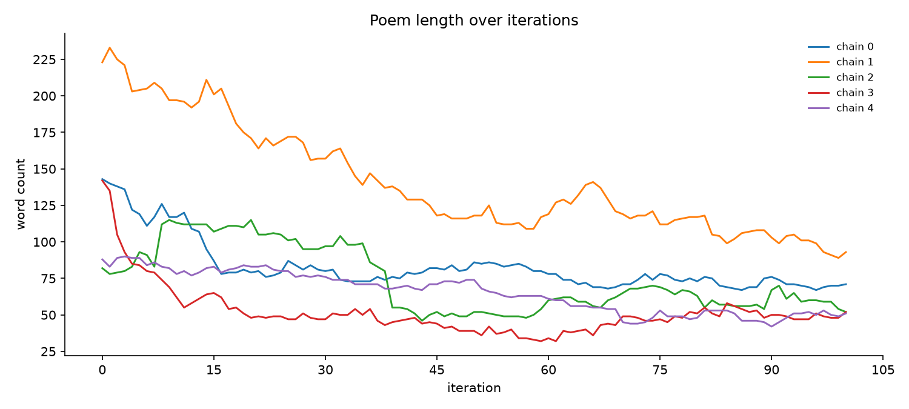
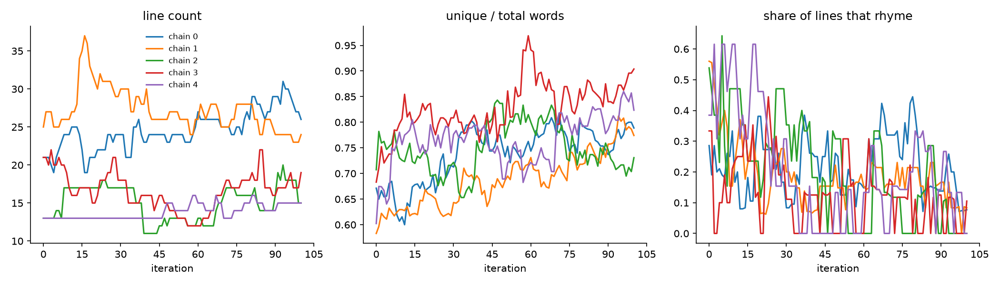

# Poem loop analysis: `2026-11-07_210935`

Model `Qwen3.6-35B-A3B-UD-Q4_K_M` · 5 chains · temperature 0.8 · judge_knows_goal=False

Embeddings: skipped (embedding_model not set)

Converged = first iteration where text similarity to the previous poem stays >= 0.95 for 10 iterations in a row.







## Overview

| chain | poems | converged | exact repeats | near-cycles (>=0.95, 2+ back) | mean text sim (last 10) | errors |
|---|---|---|---|---|---|---|
| 0 | 101 | did not converge | none | none | 0.900 | 0 |
| 1 | 101 | did not converge | none | 3 (first at 53, lag 3) | 0.934 | 0 |
| 2 | 101 | did not converge | none | 1 (first at 96, lag 2) | 0.901 | 0 |
| 3 | 101 | did not converge | none | none | 0.917 | 0 |
| 4 | 101 | did not converge | none | none | 0.908 | 0 |

## Do chains end up in the same place?

Text similarity (difflib) between the **last** poem of each chain:

| | c0 | c1 | c2 | c3 | c4 |
|---|---|---|---|---|---|
| c0 | 1.00 | 0.21 | 0.14 | 0.24 | 0.24 |
| c1 | 0.21 | 1.00 | 0.31 | 0.21 | 0.21 |
| c2 | 0.14 | 0.31 | 1.00 | 0.28 | 0.34 |
| c3 | 0.24 | 0.21 | 0.28 | 1.00 | 0.10 |
| c4 | 0.24 | 0.21 | 0.34 | 0.10 | 1.00 |

Mean off-diagonal text similarity: **0.228**

## Chain 0

- **Did not converge.**
- No exact repeats.
- No near-cycles.
- Drift, first -> last: lines 21 -> 26, words 143 -> 71, unique/total 0.67 -> 0.79, rhyme share 0.29 -> 0.08
- Top content words, first 10 poems: stone, river, silent, water, pause, warm, decree, night, sea, root
- Top content words, last 10 poems: stone, water, jaw, valley, lichen, white, splitting, lip, river, curve

**Final poem (iteration 100):**

```
**The Valley’s Jaw**

Lichen bleaches
white, gnawing the lip,
splitting stone
where the hinge gives way.

The river dissolves
the hollow curve,
polishing edges
to grit;
dust settles
in the teeth.

Silt fills
the throat,
swallowing
the current.
Red clay bleeds
into splits
where the current gnaws—
a rust that outlasts the rain.

Black loam
holds its breath
below.

The ridge tenses.
Bedrock shifts.
A crack opens—
light bleeds in.
```

## Chain 1

- **Did not converge.**
- No exact repeats.
- Near-cycles: 3; first: poem 53 ~ poem 50 (lag 3, sim 0.950). Most common lags: [(2, 2), (3, 1)]
- Drift, first -> last: lines 25 -> 24, words 223 -> 93, unique/total 0.58 -> 0.77, rhyme share 0.56 -> 0.08
- Top content words, first 10 poems: quiet, love, gold, song, stone, iron, hold, world, cold, silence
- Top content words, last 10 poems: hollow, cold, stone, palms, lintel, light, gorge, gullet, frost, ice

**Final poem (iteration 100):**

```
**Lintel**

Light pins the gorge’s gullet
to the stone.
Frost grips the granite,
ice gnaws its teeth into the rock.
Lichen sheds its white crust
while the river chokes on silt,
grinding the valley
until the fracture
holds.

The stone shudders,
exhaling a moan
hollow and low.
Moisture sweats from the seams,
mortar crumbling.
Our palms press cold
into the dark stone.

Damp settles;
skin adheres like sap.
In the hollow frame
slick with palms before ours,
we add our own.
Shoulder pressed to arch,
the cold learns the shape of us.
```

## Chain 2

- **Did not converge.**
- No exact repeats.
- Near-cycles: 1; first: poem 96 ~ poem 94 (lag 2, sim 0.953). Most common lags: [(2, 1)]
- Drift, first -> last: lines 13 -> 15, words 82 -> 52, unique/total 0.71 -> 0.73, rhyme share 0.54 -> 0.00
- Top content words, first 10 poems: day, quiet, dusk, hour, sun, shadows, star, pine, moon, silver
- Top content words, last 10 poems: reef, air, jaw, tide, sunlight, spits, brine, dusk, chokes, kelp

**Final poem (iteration 100):**

```
**The Maw**

The tide gnaws stone.
Sunlight bleeds on the reef’s gums.

The reef spits brine,
scalding the air.

Dusk chokes on kelp.
The sky clenches,
a drawn bow.

The air turns heavy—
thick with rust.
A gull’s cry
splits the throat of the deep.

The jaw shuts.
Silence,
forced.
```

## Chain 3

- **Did not converge.**
- No exact repeats.
- No near-cycles.
- Drift, first -> last: lines 21 -> 19, words 142 -> 52, unique/total 0.68 -> 0.90, rhyme share 0.33 -> 0.11
- Top content words, first 10 poems: dust, air, light, claiming, settling, room, outside, clouds, shadows, clock
- Top content words, last 10 poems: pale, wallpaper, sloughs, air, rust, wet, wool, plaster, salt, splintered

**Final poem (iteration 100):**

```
**Asphyxiation**

Wallpaper sloughs,
raw wound
peeling to pale bone.
The air clots—
thick with rust,
heavy as wet wool.

Plaster traces
salt tracks,
wood dust sifts
from the splintered rib.

Floorboards groan.
The beam splits,
exhaling
a cloud of spores.

The mirror gapes,
swallowing
the light
into the room’s dark throat.
```

## Chain 4

- **Did not converge.**
- No exact repeats.
- No near-cycles.
- Drift, first -> last: lines 13 -> 15, words 88 -> 51, unique/total 0.60 -> 0.82, rhyme share 0.38 -> 0.00
- Top content words, first 10 poems: day, dark, light, shadows, weight, sun, grass, cold, sinks, heavy
- Top content words, last 10 poems: seam, weight, cold, weld, light, granite, shadows, rime, clamps, reeds

**Final poem (iteration 100):**

```
**The Cold Weld**

Light slices
granite’s throat.
Shadows stiffen
on the ridge’s pale crest.

Rime clamps the reeds;
frost-tendons
pin the ground to the sky.
Bedrock’s scarred seam
groans under weight.

Ice seizes.
A lock.
Beneath the weight of years,
the crack forgets it was broken—
fused.
```
